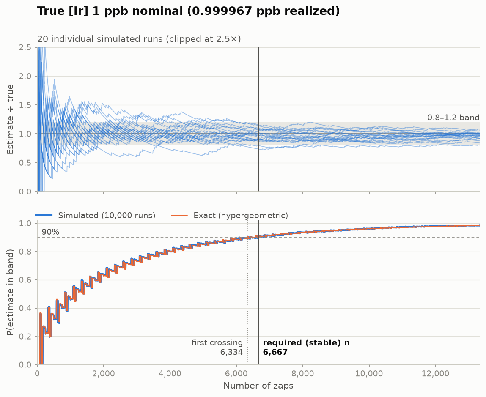
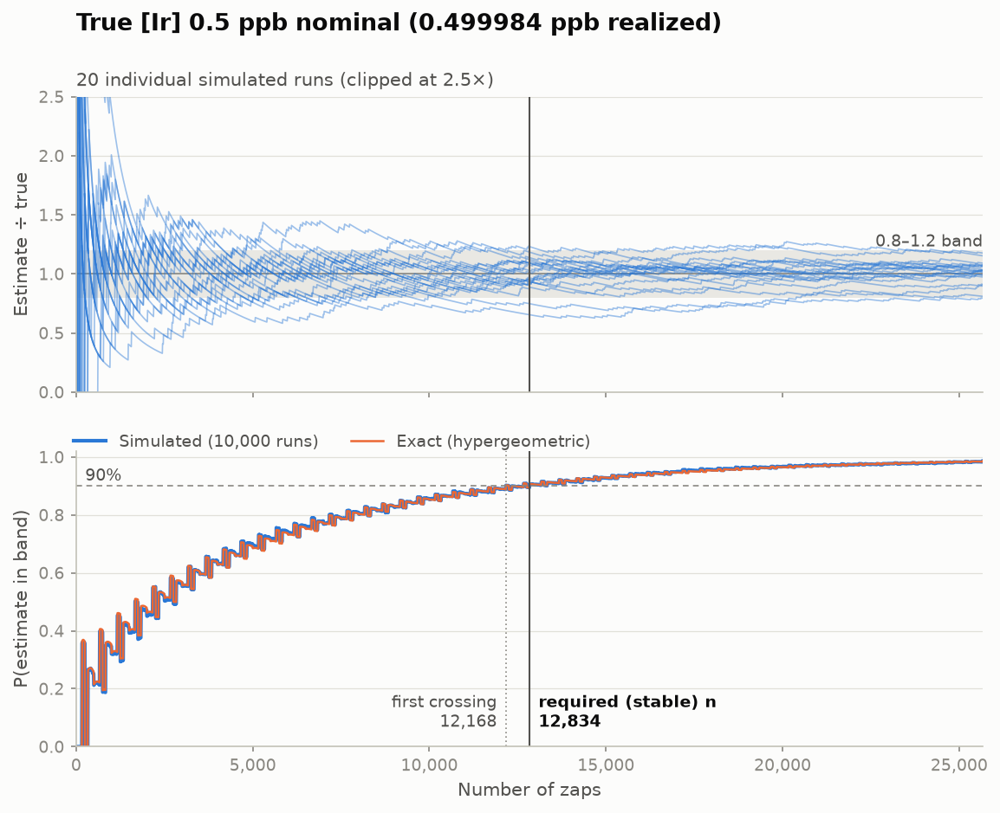
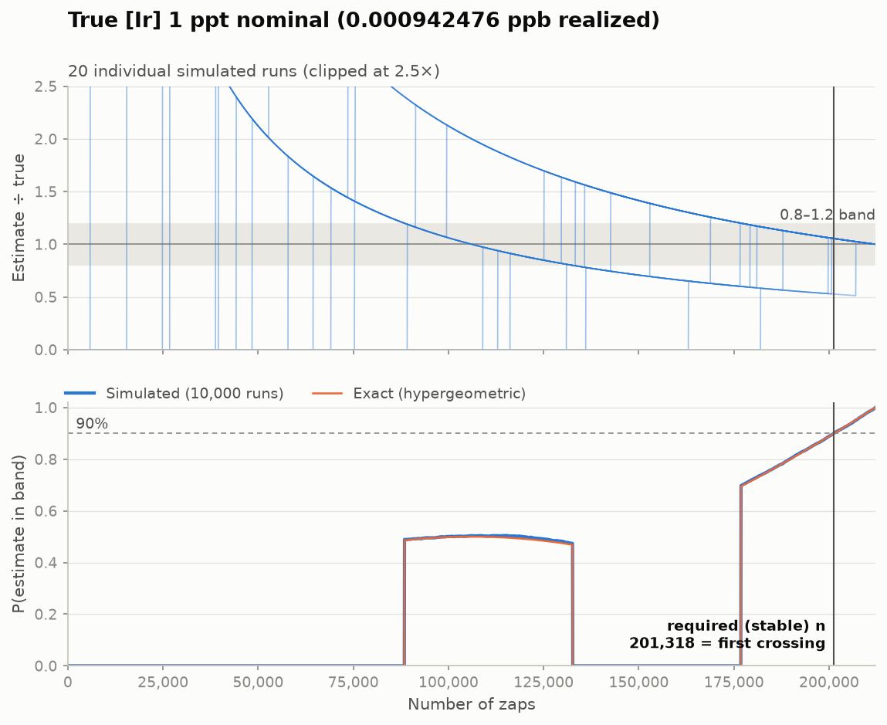

# Ir zap simulator v1: results

**Best case for blind (uniform random) sampling, assuming every spherule is exactly one spot in size at 100 ppb and the rest of the rock is 0 ppb.**

Slide: 3 cm × 2 cm, 60 µm spot, treated as 212,207 spot-sized cells. A run succeeds at n zaps when its estimate is within 0.8–1.2× the slide's realized concentration (edges included). "Required zaps" is the stable n: the smallest n at which at least 90% of runs succeed at that n and at every larger n. All headline numbers are exact (hypergeometric); the simulation is a cross-check.

## Summary

| Nominal [Ir] | Realized [Ir] | Spherules | Required zaps (stable n) | First crossing | % of slide | Machine hours | Cost | Verdict |
|---|---|---|---|---|---|---|---|---|
| 1 ppb | 0.999967 ppb | 2,122 | 6,667 | 6,334 | 3.1% | 444 | $44,447 | **Costly** |
| 0.5 ppb | 0.499984 ppb | 1,061 | 12,834 | 12,168 | 6.0% | 856 | $85,560 | **Infeasible** |
| 1 ppt | 0.000942476 ppb | 2 | 201,318 | 201,318 | 94.9% | 13,421 | $1,342,120 | **Infeasible** |

Cost basis: 15 zaps per hour at $100 per hour. % of slide, hours and cost are for the stable n.

## Feasibility verdicts

**Placeholder limits pending a real budget/instrument allocation from the team:** Feasible up to 100 machine hours; Costly up to 500 hours; Infeasible above 500 hours or above 50% of the slide; Impossible when no number of zaps on the slide is enough.

- **1 ppb: Costly** under blind random sampling with 100 ppb one-cell spherules: 444 machine hours is between the 100 h and 500 h limits.
- **0.5 ppb: Infeasible** under blind random sampling with 100 ppb one-cell spherules: 856 machine hours exceeds the 500 h limit.
- **1 ppt: Infeasible** under blind random sampling with 100 ppb one-cell spherules: 13,421 machine hours exceeds the 500 h limit and 94.9% of the slide exceeds the 50% limit.

Notes:

- Targeted sampling (for example Fe-rich areas only, planned for v2) could reduce the required zaps, so an Infeasible verdict here does not rule out targeted strategies.
- Required zaps scale roughly with spherule grade ÷ bulk concentration: richer, rarer spherules (for example 1 ppm) would need roughly proportionally more zaps.

## Simulation cross-check

Overall: **PASS**. 10,000 runs per concentration, seed 20261111. The simulated success fraction must stay within 5 standard errors of the exact probability at every checked n (log-spaced n across the slide plus every n within ±10% of the exact first crossing and stable n).

| Nominal [Ir] | Check | n values checked | Largest gap (SE) | at n | Largest gap (points) | at n | Simulated stable n* | Simulated first crossing* |
|---|---|---|---|---|---|---|---|---|
| 1 ppb | PASS | 1,801 | 2.87 | 108 | 1.38 | 108 | 6,667 | 6,334 |
| 0.5 ppb | PASS | 3,333 | 2.62 | 1,961 | 1.31 | 1,961 | 12,834 | 12,168 |
| 1 ppt | PASS | 31,189 | 2.56 | 211,965 | 0.83 | 121,857 | 201,225 | 201,225 |

\* Simulated, noisy, informational only. These never decide pass or fail.

## Figures

### 1 ppb



### 0.5 ppb



### 1 ppt



## Parameters

Full record in `params.json`.

```json
{
  "slide_width_cm": 3.0,
  "slide_height_cm": 2.0,
  "spot_diameter_um": 60.0,
  "grade_ppb": 100.0,
  "hit_threshold_ppb": 100.0,
  "concentrations_ppb": [
    1.0,
    0.5,
    0.001
  ],
  "band_low": 0.8,
  "band_high": 1.2,
  "confidence": 0.9,
  "zaps_per_hour": 15.0,
  "usd_per_hour": 100.0,
  "feasible_max_hours": 100.0,
  "infeasible_min_hours": 500.0,
  "infeasible_slide_fraction": 0.5,
  "runs": 10000,
  "seed": 20261111,
  "trajectories": 20,
  "k_se": 5.0,
  "log_points": 200,
  "window_fraction": 0.1
}
```
